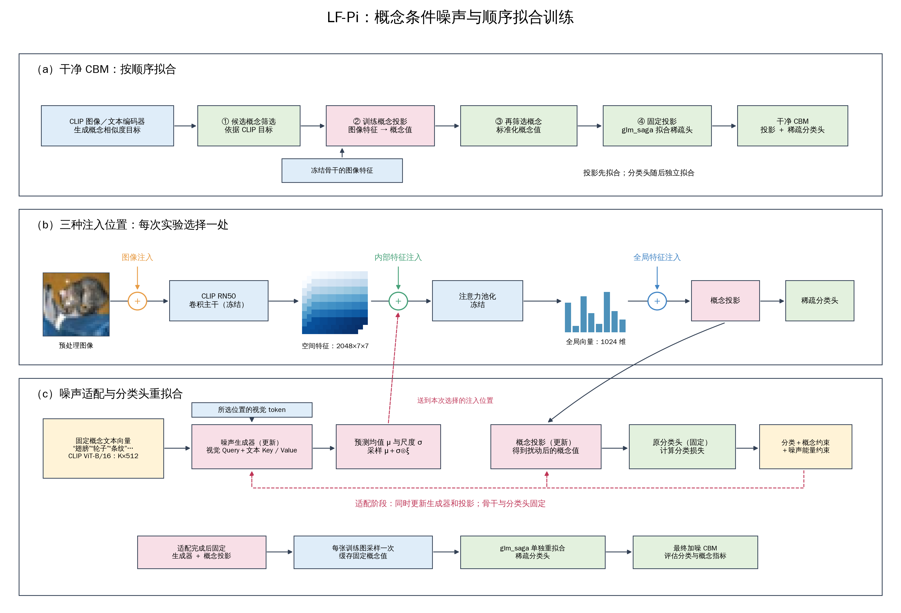
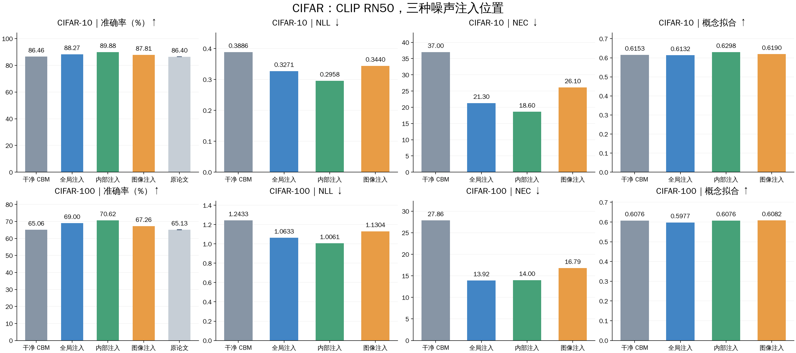
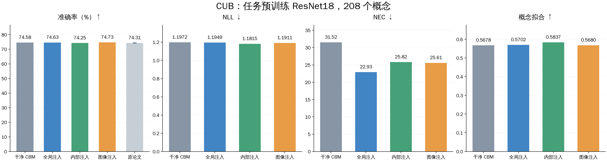
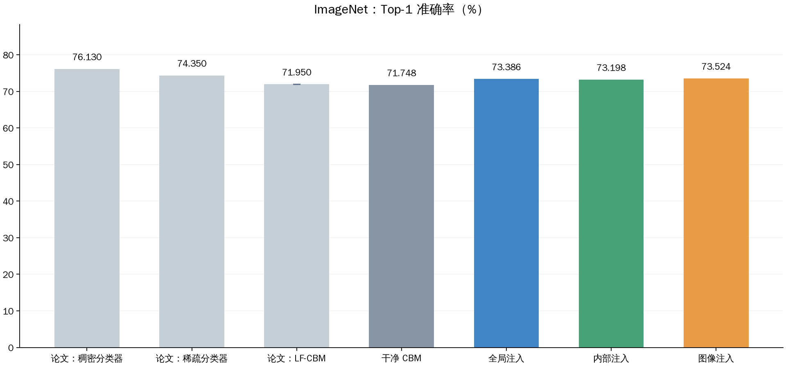
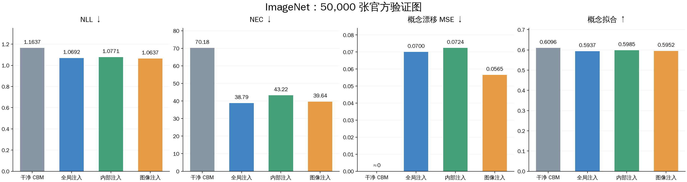
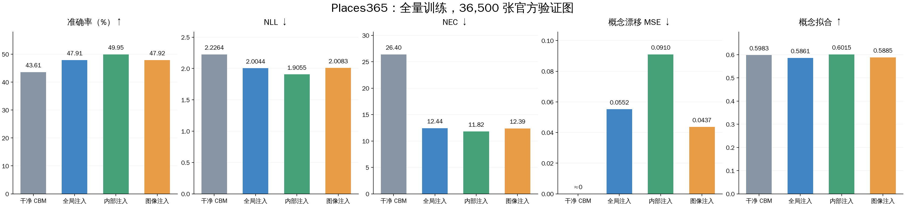

# LF-Pi 实验结果

## 1. 方法流程

以输入尺寸 224×224 的 **CLIP RN50** 为例，三种注入位置的具体输入如下。`B` 为一批图像的数量；生成器另读取固定的概念文本向量 `T∈ℝ^{K×512}`，其中 `K` 为保留概念数，`512` 为 CLIP ViT-B/16 文本嵌入维度。

- **图像注入（target_image）**：输入经过缩放、裁剪和 CLIP 标准化的图像，形状为 **`[B, 3, 224, 224]`**；四个维度依次为批量、RGB 通道、高度、宽度。生成器先读取池化到 14×14 的图像，展平为 **`[B, 196, 3]`**，其中 196 是空间网格数，3 是每格 RGB 值；预测的均值和标准差插值回 `[B, 3, 224, 224]`，在完整图像分辨率采样并加噪。
- **内部特征注入（target_internal）**：输入 CLIP RN50 的 `layer4` 输出、注意力池化前的特征，形状为 **`[B, 2048, 7, 7]`**；四个维度依次为批量、特征通道、网格高度、网格宽度。生成器读取展平后的 **`[B, 49, 2048]`**，其中 49 是空间位置数，每个位置包含 2048 维视觉特征；加噪后继续经过冻结的注意力池化。
- **全局特征注入（target_global）**：输入注意力池化后的全局图像向量，形状为 **`[B, 1024]`**；两个维度依次为批量、全局视觉嵌入维度。生成器读取 **`[B, 1, 1024]`**，其中 1 表示每张图只有一个全局 token；加噪后的全局向量直接进入概念投影。

干净 CBM 采用顺序拟合：先依据 CLIP 概念目标筛选候选概念，训练图像特征到概念值的投影；再筛选和标准化概念；最后固定投影，用 `glm_saga` 单独拟合稀疏分类头。后续 `finetune_projection` 同时更新噪声生成器和概念投影，完成后固定两者并重拟合分类头。

方法对照表与指标定义见 [details.md](details.md)。

## 2. 实验结果

### 2.1 CIFAR-10与CIFAR-100

两套CIFAR实验均以CLIP RN50为backbone、CLIP ViT-B/16提供概念文本及教师目标。各用完整50,000张官方训练图从头拟合干净CBM；噪声适配另使用其中45,000张训练、5,000张验证；评估使用10,000张官方测试图。CIFAR-10最终保留132个概念，CIFAR-100保留824个。三种位置均使用概念条件交叉注意力、20轮训练、批量256、生成器学习率$3\times10^{-4}$、投影学习率$10^{-5}$、梯度范数上限1.0。

### 2.2 CUB-200-2011

CUB使用导入的LF-CBM ResNet-18检查点作为起点(已用CUB预训练过），保留208个概念。
原训练集5,990张中，4,990张用于噪声适配训练、1,000张用于适配选模，完整官方测试集5,790张用于评估。
三种位置均用概念条件交叉注意力、20轮`finetune_projection`及其后的5,000步官方`glm_saga`分类头重拟合；生成器学习率$10^{-3}$.

### 2.3 ImageNet 200+10子集

**数据与训练设置。** 使用通过标签质检的ImageNet子集，每类200张训练图、10张噪声适配验证图，共200000张训练图和10000张适配验证图；最终在50,000张官方验证图上评估。三种加噪实验都使用`finetune_projection`训练20轮，再用官方`glm_saga`重拟合分类头。

**原论文基线。** ImageNet上的LF-CBM为71.95%±0.05%。论文同时列出稠密标准分类器76.13%、稀疏标准分类器74.35%。原文报告的LF-CBM概念数为4,505。[LF-CBM原论文](https://arxiv.org/abs/2304.06129)

### 2.4 Places365（全量训练，官方验证集36,500张，seed=0）

## 参考文献

- [Label-Free Concept Bottleneck Models](https://arxiv.org/abs/2304.06129)：概念投影、概念筛选与稀疏分类头的基线框架
- [Enhance Vision-Language Alignment with Noise](https://arxiv.org/abs/2412.10817)：PiNI的可学习高斯噪声、视觉/文本注入与生成器条件设计。
- [Positive-incentive Noise](https://arxiv.org/abs/2212.09541)及[Variational Positive-incentive Noise](https://arxiv.org/abs/2306.07651)：Pi噪声概念与变分建模背景。
- [VLG-CBM](https://arxiv.org/abs/2408.01432)：NEC定义与概念使用量评估。
