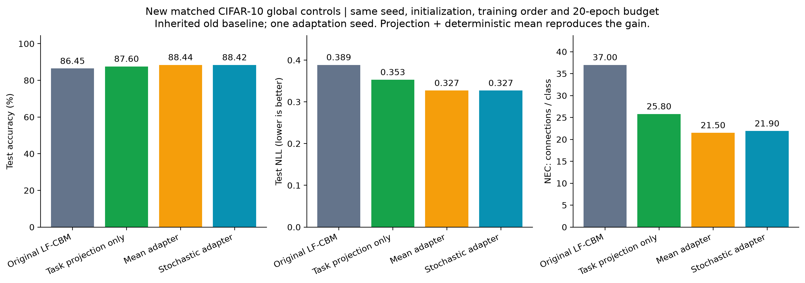
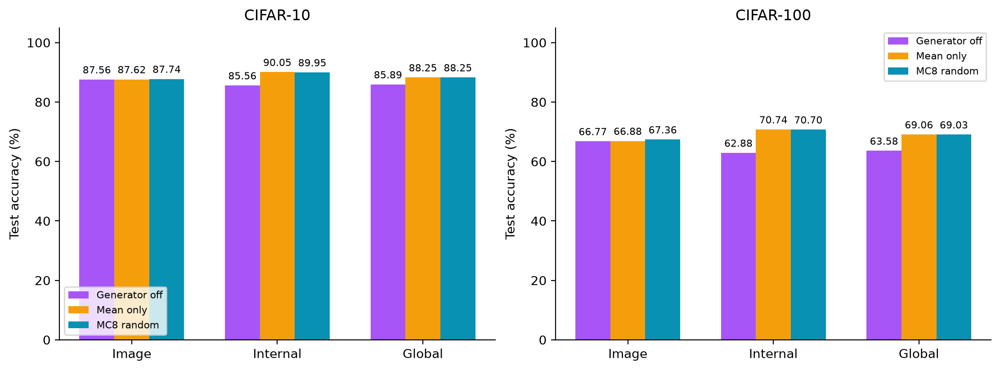
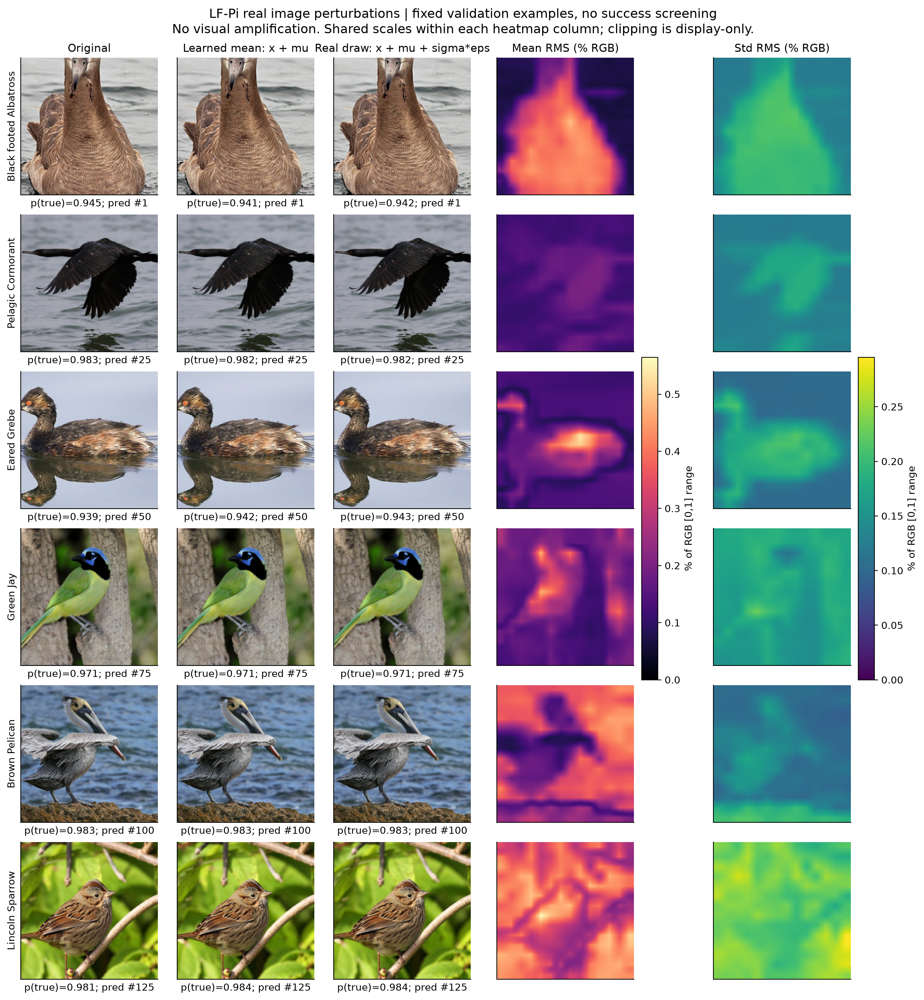
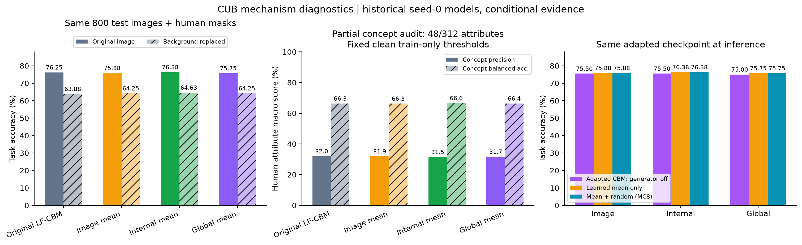

# LF-Pi 噪声机制实验

## 1. 投影适配、均值与随机噪声

适配流程同时训练噪声生成器与概念投影，随后重拟合稀疏分类头。CIFAR 使用通用 CLIP RN50，CUB 使用在 CUB 上训练过的 ResNet18。

适配期间分类头固定，NEC 在重拟合分类头后变化。CIFAR-10 内部生成器有 463,040 个可学习参数，全局生成器有 264,384 个。指标定义见 [details.md](details.md)。

### 实验 A：全局特征配对训练

使用相同干净模型、生成器初始化、训练顺序和损失设置，训练 20 轮。45,000 张图用于训练，5,000 张用于验证，按验证 NLL 选择模型；骨干与适配期间的分类头固定。

| CIFAR-10，完整 10,000 张测试图 | 准确率 | NLL | NEC |
|---|---:|---:|---:|
| 原始干净模型 | 86.45% | 0.3886 | 37.00 |
| 只重拟合干净分类头 | 86.47% | 0.3886 | 37.40 |
| 只微调任务投影，再重拟合头 | 87.60% | 0.3529 | 25.80 |
| 投影 + 确定性均值适配，再重拟合头 | **88.44%** | 0.3270 | **21.50** |
| 投影 + 均值/随机尺度，再重拟合头，MC8 | 88.42% | **0.3270** | 21.90 |



任务投影适配后准确率为 87.60%，加入确定性均值后为 88.44%，NEC 从 37.00 降至 21.50。均值适配相对投影微调增加 0.84 个百分点，配对图像 bootstrap 95% CI 为 [0.44, 1.23]；随机版本相对确定性版本变化为 −0.02 个百分点，CI 为 [−0.09, 0.05]。

### 实验 B：完整测试集推理分解

对同一个检查点分别关闭生成器、只保留均值 μ、以及使用 μ＋σξ 的 8 次采样概率平均（MC8）。

| 数据集 / 注入位置 | 原始基线 | 适配模型，生成器关闭 | 仅 μ | μ+σξ，MC8 | MC8−仅 μ，百分点，95% CI |
|---|---:|---:|---:|---:|---|
| CIFAR-10 / 图像 | 86.45% | 87.56% | 87.62% | 87.74% | +0.12 `[−0.10, 0.35]` |
| CIFAR-10 / 内部 | 86.45% | 85.56% | **90.05%** | 89.95% | −0.10 `[−0.20, 0.00]` |
| CIFAR-10 / 全局 | 86.45% | 85.89% | 88.25% | 88.25% | 0.00 `[−0.07, 0.07]` |
| CIFAR-100 / 图像 | 65.00% | 66.77% | 66.88% | **67.36%** | **+0.48 `[0.17, 0.80]`** |
| CIFAR-100 / 内部 | 65.00% | 62.88% | **70.74%** | 70.70% | −0.04 `[−0.17, 0.09]` |
| CIFAR-100 / 全局 | 65.00% | 63.58% | 69.06% | 69.03% | −0.03 `[−0.12, 0.07]` |



内部注入的主要提升在仅均值推理中保留，关闭整个生成器后准确率下降。CIFAR-100 图像注入的随机推理比仅均值高 0.48 个百分点。对应 NEC 见 [分类准确率与 NEC 图](reports/noise_mechanism_v1/05_cifar_accuracy_nec.png)。

## 2. 图像扰动与背景干预

### 实验 C：图像、均值与标准差

使用真实 LF-Pi 图像注入检查点，按固定类别与前景面积条件选择六张验证图，展示原图、均值图、固定采样扰动图、RGB 单位下的均值 RMS 与标准差 RMS。各列热图使用统一尺度，展示原幅度扰动。



原图和加噪图肉眼几乎一致。固定 800 张 CUB 测试图上，标准差 RMS 为前景 0.1758% RGB、背景 0.1604% RGB；背景−前景为 −0.01544% RGB，配对 95% CI 为 [−0.01816%, −0.01280%]。随机扰动在前景略强。均值 RMS 为前景 0.2374%、背景 0.2532%；正向真实类别 CAM 的前景质量从 32.5009% 变为 32.5952%。

补充图：[前景轮廓与 CAM](reports/noise_mechanism_v1/02_foreground_cam.png)、[区域幅度与随机项 NLL](reports/noise_mechanism_v1/04_noise_amplitude.png)。

### 实验 D：前景掩膜、背景替换与概念标签

使用 CUB 人工分割掩膜保留图像前景并替换背景，同时评估移除背景和移除前景。供体背景按固定批次循环分配，其鸟体区域用背景颜色中位数填补。

划分为 4,990 张训练图、1,000 张验证图和 5,790 张测试图。固定抽取 800 张测试图，使用 MC8 推理。

| 模型 | 原图准确率 | 替换背景准确率 | 相对原始模型的替换背景增益，百分点，95% CI |
|---|---:|---:|---|
| 原始 LF-CBM | 76.25% | 63.88% | — |
| 图像均值适配 | 75.88% | 64.25% | +0.38 `[−0.50, 1.25]` |
| 内部均值适配 | 76.38% | 64.63% | +0.75 `[−0.75, 2.25]` |
| 全局均值适配 | 75.75% | 64.25% | +0.38 `[−0.75, 1.50]` |

概念评价匹配 48/312 项单色部位属性，使用 certainty≥3 的人工标签，共 32,484 个图像—属性对。映射和阈值在训练集上确定；所有模型使用相同阈值，匹配概念标准化值的 sigmoid 最大值作为评分。

| 原图，固定阈值 | 属性宏精确率 | 属性宏平衡准确率 | 精确率相对基线变化，百分点，95% CI |
|---|---:|---:|---|
| 原始 LF-CBM | 32.00% | 66.35% | — |
| 图像均值适配 | 31.92% | 66.25% | −0.08 `[−0.24, 0.10]` |
| 内部均值适配 | 31.48% | 66.65% | −0.51 `[−0.86, −0.16]` |
| 全局均值适配 | 31.70% | 66.36% | −0.30 `[−0.52, −0.08]` |



换背景后准确率下降约 11–12 个百分点。三种适配模型较基线的换背景准确率分别提高 0.38、0.75 和 0.38 个百分点；48 项人工属性的宏精确率分别变化 −0.08、−0.51 和 −0.30 个百分点。

## 3. 后续方法记录

[SALF-CBM](https://github.com/itaybenou/show-and-tell) 使用空间概念图与可微空间池化。官方 ImageNet 预训练模型在 50,000 张验证图上取得 75.56%（37,780/50,000），NEC 为 29.742。封装后的类别输出、概念值与概念图均与官方结果一致，空间均值和尺度头均获得非零梯度。配置与结果见 [SALF-Pi](../SALF-Pi/EXPERIMENT_REPORT.md)。

其他候选方法见 [method_candidates.json](reports/noise_mechanism_v1/method_candidates.json)。

## 4. 复现与文件

在 LF-Pi 目录、`pi-cbm` 环境运行：

```bash
python scripts/analyze_cub_noise_mechanism.py
python scripts/analyze_cifar_noise_mechanism.py --dataset cifar10
python scripts/analyze_cifar_noise_mechanism.py --dataset cifar100
python scripts/train_cifar10_mechanism_controls.py
python scripts/audit_cub_native_mechanism.py
python scripts/plot_noise_mechanism.py
python scripts/package_noise_mechanism.py
```

检查点与逐样本预测位于 `artifacts/mechanism_v1/`；结果图、CSV、映射协议和配对区间位于 `reports/noise_mechanism_v1/`。完整数据集结果见 [EXPERIMENT_REPORT.md](EXPERIMENT_REPORT.md)。
